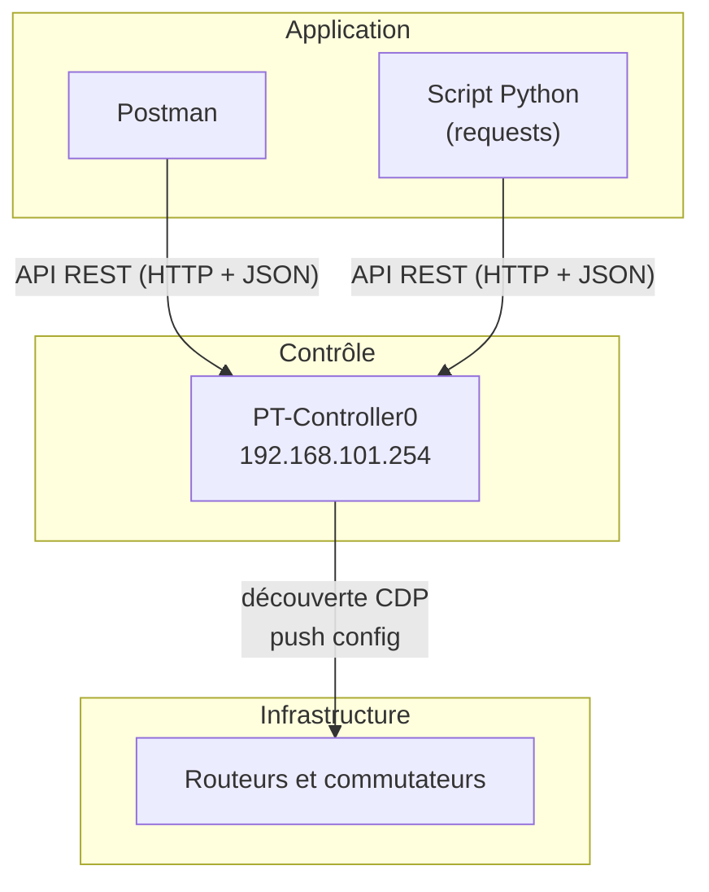

# 🧠 SDN : piloter un réseau par API REST

Gestion centralisée d'un réseau avec un **contrôleur SDN** sous **Cisco Packet Tracer** : découverte automatique des équipements, déploiement d'une configuration commune en un clic, puis interrogation du contrôleur par **API REST** avec **Postman** et un script **Python**.

[⬅ Retour au portfolio](https://github.com/EvanBienvenu/EvanBienvenu)

## Contexte

Configurer un réseau équipement par équipement en ligne de commande devient long et risqué dès qu'il y a des dizaines d'appareils. Le **SDN** centralise cette gestion dans un contrôleur, que l'on peut aussi piloter par programme. C'est une compétence clé de l'automatisation réseau et du **DevOps**.

## Objectifs

- Faire découvrir automatiquement le réseau par le contrôleur
- Définir une politique commune (DNS, NTP, Syslog) et la déployer sur tous les équipements
- S'authentifier sur l'API REST du contrôleur et obtenir un jeton
- Lister les équipements et les hôtes avec Postman, puis avec Python

## Architecture



## Étapes

### 1. Découverte du réseau

Le contrôleur reçoit l'adresse d'**un seul** équipement d'entrée (le commutateur SWL1). À partir de lui, il découvre tous les autres de voisin en voisin grâce à **CDP**.

### 2. Politique réseau commune

| Paramètre | Valeur |
| --- | --- |
| Domaine DNS | example.com |
| Serveur DNS | 192.168.101.100 |
| Serveur NTP | 192.168.101.100 |
| Serveur Syslog | 192.168.101.100 |

Un clic sur **Push config** déploie ces réglages sur tous les équipements gérés en même temps.

### 3. API REST avec Postman

| Étape | Requête | Détail |
| --- | --- | --- |
| Obtenir un jeton | `POST /api/v1/ticket` | Corps JSON avec l'identifiant et le mot de passe ; la réponse contient `serviceTicket` |
| Lister les équipements | `GET /api/v1/network-device` | En-tête `X-Auth-Token: <jeton>` |
| Lister les hôtes | `GET /api/v1/host` | En-tête `X-Auth-Token: <jeton>` |

### 4. Automatisation en Python

Le script [`sdn_inventaire.py`](sdn_inventaire.py) enchaîne les trois requêtes : il demande le mot de passe sans l'afficher, récupère un jeton, puis affiche les équipements et les hôtes sous forme de tableau.

```bash
pip install requests
python sdn_inventaire.py --controleur http://192.168.101.254 --utilisateur cisco
```

## CLI ou SDN ?

| | CLI classique | Contrôleur SDN |
| --- | --- | --- |
| Configuration | Équipement par équipement | Centralisée, en un clic |
| Vue du réseau | Un équipement à la fois | Globale |
| Découverte | Manuelle | Automatique (CDP) |
| Risque d'erreur | Élevé | Réduit |
| Automatisation | Limitée | API REST + Python |

## Ce que j'ai appris

- Le principe du SDN et ses trois couches (application, contrôle, infrastructure)
- Utiliser une API REST : méthodes HTTP, en-têtes, réponses JSON, codes de retour
- Pourquoi un **jeton** est plus sûr que l'envoi du mot de passe à chaque requête
- Automatiser une tâche réseau avec Python et la bibliothèque `requests`

## Compétences mobilisées

[SDN et API REST](https://github.com/EvanBienvenu/competences-reseau/blob/main/08-sdn-api-rest.md) · Python

## 📖 Termes techniques

| Terme | Explication |
| --- | --- |
| **SDN** | *Software Defined Networking* : gestion du réseau centralisée dans un logiciel, le contrôleur. |
| **Contrôleur SDN** | Équipement central qui connaît tout le réseau et configure les équipements. |
| **CLI** | Ligne de commande : configuration en tapant des commandes sur chaque équipement. |
| **CDP** | *Cisco Discovery Protocol* : protocole qui permet à un équipement Cisco de découvrir ses voisins. |
| **Push config** | Envoi d'une configuration à tous les équipements à la fois. |
| **DNS / NTP / Syslog** | Services de résolution de noms, de synchronisation de l'heure et de centralisation des journaux. |
| **API REST** | Moyen pour deux logiciels de communiquer par des requêtes web (HTTP). |
| **GET / POST** | Méthodes HTTP pour lire une information / en envoyer une. |
| **JSON** | Format texte structuré utilisé pour échanger des données. |
| **Jeton (token)** | Clé temporaire remise après authentification, utilisée à la place du mot de passe. |
| **Postman** | Logiciel qui permet d'envoyer facilement des requêtes à une API. |
| **requests** | Bibliothèque Python pour envoyer des requêtes HTTP. |

Tous les termes sont aussi expliqués dans le [glossaire du portfolio](https://github.com/EvanBienvenu/EvanBienvenu/blob/main/GLOSSAIRE.md).
